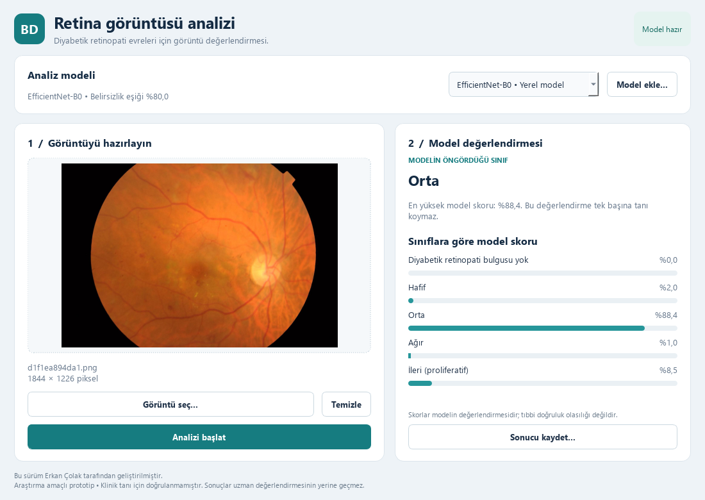

# Blindless Detection

Retina görüntülerini beş diyabetik retinopati sınıfı için değerlendiren, model seçimi ve sonuç dışa aktarma özelliklerine sahip masaüstü araştırma uygulaması.




Uygulama PyQt5 ve PyTorch kullanır. Görüntüler bu bilgisayarda işlenir. Model skorları tıbbi güvence veya doğruluk olasılığı değildir; uygulama klinik tanı için doğrulanmamıştır.

## Uygulamayı başlatma

Hazır proje ortamında **start_app.bat** dosyasına çift tıklayın. PyCharm kullanıyorsanız mevcut yorumlayıcı olarak `.venv-train/Scripts/python.exe` dosyasını seçip `run.py` dosyasını çalıştırın.

Terminalden başlatmak için proje klasöründe:

```powershell
.venv-train\Scripts\python.exe run.py
```

## Kullanım

1. **Analiz modeli** listesinden kullanmak istediğiniz eğitilmiş modeli seçin.
2. **Görüntü seç…** ile PNG, JPG veya BMP dosyası açın; dosyayı pencereye sürükleyerek de ekleyebilirsiniz.
3. Önizlemeyi kontrol edip **Analizi başlat** düğmesine basın.
4. Modelin önerdiği sınıfı ve beş sınıfın skorlarını inceleyin. En yüksek skor modelin kabul eşiğinin altındaysa **Sonuç belirsiz** gösterilir.
5. **Sonucu kaydet…** ile tarih, görüntü adı, model bilgisi, eşik ve sınıf skorlarını içeren JSON raporu oluşturun.

Yeni görüntü veya model seçildiğinde önceki sonuç temizlenir. Analiz arka planda yürütülür; arayüz işlem sırasında yanıt vermeye devam eder.

## Model ekleme

**Model ekle…** düğmesiyle uyumlu bir `.pt` model dosyası seçin. Dosya doğrulandıktan sonra `models/` klasörüne mevcut modelleri ezmeden eklenir. Uyumlu olmayan dosya etkin modelin yerini almaz.

Desteklenen mimariler **EfficientNet-B0**, **EfficientNet-B3** ve **EfficientNetV2-S**'dir. Listede yalnızca mevcut model dosyaları gösterilir. Dosya; model ağırlıklarını, beş sınıfın sırasını, ön işleme sürümünü, görüntü boyutunu ve kalibrasyon bilgilerini içermelidir. TensorFlow/Keras `.h5` dosyaları bu akışla uyumlu değildir.

## Google Colab üzerinde eğitim

[Tek defter eğitim dosyasını](colab/Blindless_APTOS_T4_Tek_Defter.ipynb) Google Colab'de açın ve **T4 GPU** seçin. Hazırlık, model tanımı, eğitim ve değerlendirme kodları hücrelerde görünür; ayrıca kod paketi yüklemek gerekmez.

APTOS verisinin Drive'daki konumu:

```text
/content/drive/MyDrive/aptos2019-blindness-detection
├── train.csv
└── train_images/
```

İlk aday **EfficientNet-B3 / 300 × 300**, alternatif aday **EfficientNetV2-S / 384 × 384**'tür. ImageNet ağırlıklarından başlayan eğitim; yalnızca eğitim kümesinde veri artırma, sınıf ağırlıklı kayıp, isteğe bağlı MixUp, karma hassasiyet ve erken durdurma kullanır.

Mevcut veri ayrımı doğrulanarak korunur; önbellek Colab'in yerel diskinde, eğitim kayıtları Drive'da tutulur. Model seçimi ve sıcaklık kalibrasyonu doğrulama kümesinde yapılır. Son test ayrı bir adımdır. Eğitimden sonra dışa aktarılan `aptos_*.pt` dosyasını indirip uygulamadaki **Model ekle…** düğmesiyle kullanın.

Daha büyük mimari daha yüksek başarı garantisi vermez; adayları doğrulama QWK, macro F1 ve sınıf bazında duyarlılık ile karşılaştırın. Aşağıdaki ölçümler projede kayıtlı B0 modeline aittir.

## Mevcut B0 modelinin sonuçları

ImageNet başlangıcından APTOS üzerinde eğitilen B0 modeli için ayrım **2.452 eğitim / 526 doğrulama / 526 test** görüntüsüdür. Kayıtlı test sonuçları:

- Doğruluk: **%82,51**
- Quadratic Weighted Kappa (QWK): **0,907**
- Macro F1: **0,662**
- Ağır evre duyarlılığı: **%29,63**

Ölçümlerin kaynağı: `runs/efficientnet_b0/test_metrics.json`. Ağır evredeki düşük duyarlılık önemli bir geliştirme ihtiyacıdır. Birebir piksel kopyaları temizlenmiştir; hasta düzeyinde ayrım ve yakın kopyaların dışlanması garanti edilmez. Bu test sonuçları daha önce geliştirme sırasında incelenmiştir; bağımsız klinik doğrulama olarak yorumlanmamalıdır.

## Geliştirme kontrolleri

```powershell
.venv-train\Scripts\python.exe -m unittest test_pipeline test_models test_ui -v
```

## Lisans

Kod [MIT Lisansı](LICENSE) kapsamındadır. Veri seti APTOS/Kaggle kullanım koşullarına tabidir.
